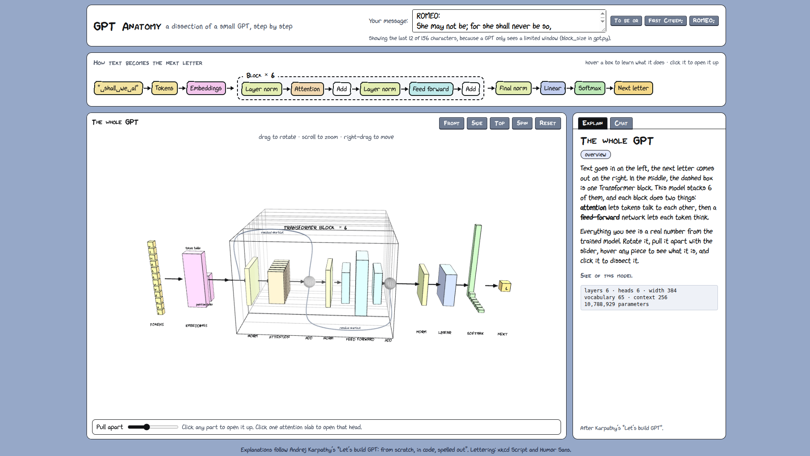
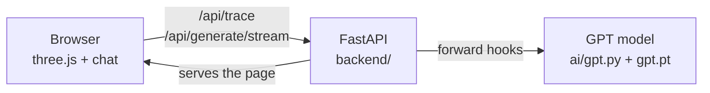

# GPT Anatomy

A small GPT built from scratch in PyTorch, plus a 3D website that opens it up so you can see what happens inside it,
one step at a time.

**Live demo: https://gpt-anatomy.onrender.com**
(free hosting: it sleeps when nobody visits, so the first load can take up to a minute, and chat replies are slow)



## What is this?

- **A real GPT.** About 10.8 million parameters, trained on tiny Shakespeare, written by following Andrej Karpathy's
  ["Let's build GPT: from scratch, in code, spelled out"](https://www.youtube.com/watch?v=kCc8FmEb1nY) lecture and
  [nanoGPT](https://github.com/karpathy/nanoGPT). The commit history follows the order of the lecture.
- **A way to look inside it.** Every number on the website comes from the trained model: the embeddings, the attention
  weights of each head, the feed-forward neurons, and the final probabilities for the next letter.
- **A text completer, not a chatbot.** It only learned one thing: given some text, guess the next character. Give it
  `ROMEO:` and it writes a few lines in the style of a play. Ask it a question and it will not answer.

## What you can do on the website

- **Follow the flow chart.** Hover any box to read what that part does, in plain words. Click it to open it up.
- **Rotate the whole model in 3D** and pull it apart with a slider. Click any part to dissect it.
- **Dissect each part:**
  - *Embeddings*: how a character becomes a row of numbers, and how the position is added.
  - *Layer norm* and *Add*: what normalising does to each token, and how the residual shortcut works.
  - *Attention*: the query, key and value of every token, which earlier tokens each one looks at (weighted lines),
    the mask that hides the future, all 6 heads and all 6 blocks.
  - *Feed forward*: the wide layer of neurons, with the ones switched off by ReLU shown empty.
  - *Output*: the score for each of the 65 characters, softmax, and a temperature slider. Pick the next letter and
    watch the whole model run again.
- **Chat with it.** The Chat tab streams a continuation one character at a time. *Visualize this* sends that text
  into the 3D views.

## How it works



- `gpt.py` is the model. The only change made for the website is that each attention head keeps its weights
  (`Head.last_wei`).
- The backend runs the model once for a text and uses PyTorch **forward hooks** to copy out every intermediate tensor,
  so the model code stays untouched.
- The page draws small slices so that everything stays readable: the first 16 of the 384 numbers per token, and 64 of
  the 1536 feed-forward neurons.
- It is one container: FastAPI serves both the API and the website.

## The model

| | |
|---|---|
| Layers / heads / width | 6 / 6 / 384 |
| Context length | 256 characters |
| Vocabulary | 65 characters (character-level) |
| Parameters | 10,788,929 |
| Data | tiny Shakespeare, about 1.1 MB |
| Training | 5000 steps, batch 64, learning rate 3e-4, dropout 0.2, on a free Colab T4 in about 50 minutes |
| Result | train loss 0.86, validation loss 1.55 |

The validation loss was a little lower in the middle of training (1.49 at step 2500), so the model overfits slightly
on this small dataset. The text looks like Shakespeare, with speaker names and mostly real words, but it makes no sense.

## Project layout

```
ai/        the model: gpt.py (model + training), bigram.py (baseline), input.txt (data),
           train_colab.ipynb (train on a free GPU), vocab.json and gpt.pt (trained weights; gpt.pt is not in git)
backend/   FastAPI app: runs the model, returns every intermediate tensor, streams generated text, serves the website
frontend/  the website: plain HTML and JavaScript with three.js, no build step
```

## Run it locally

You need [uv](https://docs.astral.sh/uv/) and the trained `ai/gpt.pt` and `ai/vocab.json` (see "Train the model").

```bash
uv sync                                              # installs the exact versions from uv.lock
uv run uvicorn app:app --app-dir backend --port 8001
```

Open http://localhost:8001 for the website and http://localhost:8001/docs for the API. Or with Docker:

```bash
docker compose up --build        # http://localhost:7860
```

## Train the model

Open `ai/train_colab.ipynb` in Google Colab with a **T4 GPU** runtime and run the cells in order (about 50 minutes).
Download `gpt.pt` and `vocab.json` into the `ai/` folder. To train locally instead: `cd ai && python gpt.py`
(slow without a GPU).

## Tests

```bash
uv run pytest backend/tests                # 38 unit and API tests, about 15 seconds, no trained weights needed
uv run pytest backend/tests -m e2e         # 17 browser tests with Playwright, about 2 minutes, needs Chrome
```

## API

| Endpoint | What it does |
|---|---|
| `GET /api/health` | model loaded? number of parameters |
| `GET /api/vocab` | the 65 characters |
| `GET /api/token-table?dims=16` | first numbers of every token embedding |
| `POST /api/trace` | every intermediate tensor for a text (`layers` and `include_hidden` choose what to return) |
| `POST /api/generate` | continue a text |
| `POST /api/generate/stream` | the same, one character at a time (server-sent events) |

## Deploying

The live site runs on Render's free plan, built from the `Dockerfile` and `render.yaml` in this repo. The free plan
gives the container only a small share of a CPU, so the 3D views work but chat replies are slow. The trained weights
are not stored on `main`; they live on a separate `deploy` branch, which is what Render builds.
Step by step: [docs/deploying.md](docs/deploying.md).

## Limitations

- It only knows Shakespeare, character by character. It is not a chatbot and has no idea what a question is.
- The website shows slices of the tensors, not all 384 numbers per token.
- The free host is slow and sleeps when idle.

## Credits

- Model and lecture: [Andrej Karpathy](https://karpathy.ai/), "Let's build GPT" and nanoGPT.
- Lettering: xkcd Script (CC BY-NC 3.0, non-commercial) and Humor Sans. See `frontend/fonts/README.md`.
- Made by [Chitraksh Suri](https://linkedin.com/in/chitrakshsuri) · [GitHub](https://github.com/ChitrakshSuri)
